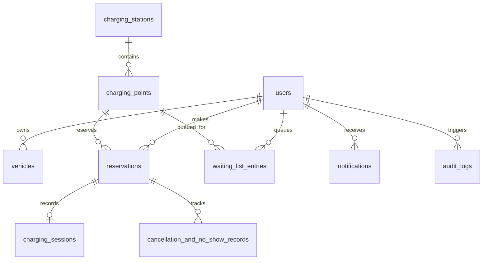

# Database Schema Specification

## PostgreSQL 16 Normalized Relational Schema
**Project:** EV Charging Reservation and Real-Time Availability System  
**Institution:** IILM University, Greater Noida  

---

### Entity Relationship Diagram (ERD)

---

### Table Definitions

#### 1. `users`
Stores registered driver profiles and system administrators.
| Column | Type | Constraints | Description |
|---|---|---|---|
| `id` | SERIAL | PRIMARY KEY | Unique user identifier |
| `full_name` | VARCHAR(255) | NOT NULL | User's full name |
| `email` | VARCHAR(255) | UNIQUE, NOT NULL | Normalized lowercase email address |
| `password_hash` | VARCHAR(255) | NOT NULL | Bcrypt hash (cost factor 10) |
| `phone` | VARCHAR(50) | NULL | Contact mobile number |
| `role` | VARCHAR(20) | CHECK (role IN ('USER', 'ADMIN', 'SUPER_ADMIN')) | Role-based authorization |
| `account_status` | VARCHAR(20) | CHECK (account_status IN ('ACTIVE', 'SUSPENDED', 'DEACTIVATED')) | Account lifecycle |
| `created_at` | TIMESTAMPTZ | DEFAULT CURRENT_TIMESTAMP | Registration timestamp (UTC) |
| `updated_at` | TIMESTAMPTZ | DEFAULT CURRENT_TIMESTAMP | Last profile modification |

#### 2. `vehicles`
Stores electric vehicles linked to user accounts.
| Column | Type | Constraints | Description |
|---|---|---|---|
| `id` | SERIAL | PRIMARY KEY | Vehicle identifier |
| `user_id` | INTEGER | FK -> users(id) ON DELETE CASCADE | Vehicle owner |
| `registration_number` | VARCHAR(50) | NULL | License plate registration |
| `vehicle_name` | VARCHAR(100) | NOT NULL | Model (e.g. Tata Nexon EV, Ioniq 5) |
| `battery_capacity_kwh` | NUMERIC(6,2) | NULL | Total pack capacity in kWh |

#### 3. `charging_stations`
Stores Greater Noida charging terminal hubs.
| Column | Type | Constraints | Description |
|---|---|---|---|
| `id` | SERIAL | PRIMARY KEY | Station identifier |
| `name` | VARCHAR(255) | NOT NULL | Commercial station name |
| `description` | TEXT | NULL | Facilities & guidelines |
| `address` | TEXT | NOT NULL | Street address |
| `city` | VARCHAR(100) | DEFAULT 'Greater Noida' | City region |
| `latitude` | NUMERIC(10,7) | NOT NULL | Geographical coordinate |
| `longitude` | NUMERIC(10,7) | NOT NULL | Geographical coordinate |
| `operating_status` | VARCHAR(30) | CHECK (IN ('OPERATIONAL', 'MAINTENANCE', 'DECOMMISSIONED')) | Facility status |
| `opening_time` | TIME | NOT NULL | Daily operational start |
| `closing_time` | TIME | NOT NULL | Daily operational end |

#### 4. `charging_points`
Stores individual dispensers/plugs at a station.
| Column | Type | Constraints | Description |
|---|---|---|---|
| `id` | SERIAL | PRIMARY KEY | Charging point identifier |
| `station_id` | INTEGER | FK -> charging_stations(id) | Associated station |
| `point_code` | VARCHAR(50) | UNIQUE(station_id, point_code) | Dispenser label (e.g. KP3-DC-01) |
| `connector_type` | VARCHAR(20) | CHECK (IN ('CCS2', 'TYPE2', 'GBT')) | Connector standard |
| `power_kw` | NUMERIC(6,2) | CHECK (power_kw > 0) | Delivery rating in kW |
| `price_per_kwh` | NUMERIC(6,2) | DEFAULT 16.50 | Tariff rate in ₹/kWh |
| `operational_status` | VARCHAR(30) | CHECK (IN ('AVAILABLE', 'OCCUPIED', 'RESERVED', 'OUT_OF_SERVICE')) | Dispenser hardware state |

#### 5. `reservations`
Stores slot reservations with concurrency validation.
| Column | Type | Constraints | Description |
|---|---|---|---|
| `id` | SERIAL | PRIMARY KEY | Reservation ID |
| `booking_reference` | VARCHAR(64) | UNIQUE, NOT NULL | Verifiable reference (EV-IILM-...) |
| `user_id` | INTEGER | FK -> users(id) | Driver who booked slot |
| `charging_point_id` | INTEGER | FK -> charging_points(id) | Dispenser reserved |
| `start_time` | TIMESTAMPTZ | NOT NULL | Start instant in UTC |
| `end_time` | TIMESTAMPTZ | NOT NULL, CHECK (end_time > start_time) | End instant in UTC |
| `status` | VARCHAR(30) | CHECK (IN ('PENDING', 'CONFIRMED', 'CHECKED_IN', 'IN_PROGRESS', 'COMPLETED', 'CANCELLED', 'NO_SHOW')) | Booking state |
| `estimated_energy_kwh` | NUMERIC(6,2) | NULL | Estimated energy transfer |
| `estimated_cost` | NUMERIC(8,2) | NULL | Estimated total price (₹) |

#### 6. `waiting_list_entries`
Stores drivers queued for busy slots.
| Column | Type | Constraints | Description |
|---|---|---|---|
| `id` | SERIAL | PRIMARY KEY | Queue entry ID |
| `user_id` | INTEGER | FK -> users(id) | Waiting user |
| `charging_point_id` | INTEGER | FK -> charging_points(id) | Desired charging point |
| `requested_start_time` | TIMESTAMPTZ | NOT NULL | Desired start |
| `requested_end_time` | TIMESTAMPTZ | NOT NULL | Desired end |
| `state_of_charge_percent` | NUMERIC(5,2) | CHECK (0 <= SOC <= 100) | Battery charge at queue time |
| `waiting_since` | TIMESTAMPTZ | DEFAULT CURRENT_TIMESTAMP | Queue timestamp |
| `reliability_score` | NUMERIC(4,3) | CHECK (0.0 <= R <= 1.0) | Driver reliability coefficient |
| `priority_score` | NUMERIC(6,4) | DEFAULT 0.0000 | Calculated score Pᵢ |
| `status` | VARCHAR(30) | CHECK (IN ('QUEUED', 'ALLOCATED', 'EXPIRED', 'CANCELLED')) | Queue state |

---

### Core Query Indexes
- `idx_reservations_point_time`: `(charging_point_id, start_time, end_time, status)` for fast overlap detection.
- `idx_reservations_user`: `(user_id)` for driver booking queries.
- `idx_waiting_list_point`: `(charging_point_id, status)` for queue retrieval during slot releases.
- `idx_audit_logs_created`: `(created_at DESC)` for administrative telemetry.

